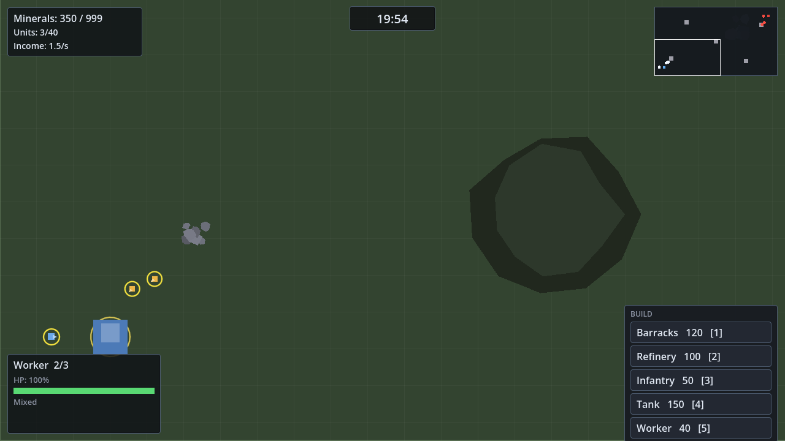

# RTS Demo

A compact **1v1 real-time strategy vertical slice** built with **Godot 4.7.2** (GDScript) —
box-select units, issue orders, watch them fight, mine ore, mass an army, and push the
enemy base. One evening to build, one clone to run.

The whole game is drawn procedurally: **zero image, audio or font files**. Clone the repo,
open it in Godot, press F5 — it runs.



---

## Play it without installing anything

A prebuilt Windows binary is committed to this repository:

**[`release/RTSDemo-win64.zip`](release/RTSDemo-win64.zip)** — 36 MB, contains `RTSDemo.exe`,
`RTSDemo.pck` and a `HOW-TO-PLAY.txt`.

1. Download the zip (GitHub → *Code* → *Download ZIP*, or the raw file link).
2. Extract it anywhere.
3. Double-click `RTSDemo.exe`.

`RTSDemo.exe` and `RTSDemo.pck` have to stay in the same folder. No Godot, no runtime,
no extra downloads.

You can confirm the download is intact by comparing its hash with the one published
next to it:

```powershell
Get-FileHash .\RTSDemo-win64.zip -Algorithm SHA256
# compare with release/RTSDemo-win64.zip.sha256
```

> The raw `.exe` is 104 MB, which is over GitHub's 100 MB per-file limit for a git
> blob — that is why the committed artifact is the compressed archive. If you want the
> uncompressed binary, grab it from the repository's **Releases** page instead.

---

## Features

| | |
|---|---|
| **Selection** | Click to select, drag to box-select (partial overlap counts), Shift to add |
| **Orders** | Right-click to move / attack / harvest, with formation spreading |
| **Units** | Infantry (cheap melee), Tank (armoured, long-range shells), Worker (harvester) |
| **Combat** | Auto-acquire targets, range and cooldown per unit, armour damage table, projectiles |
| **Pathfinding** | Grid A\* with obstacle avoidance and string-pulled paths |
| **Economy** | Ore fields, worker round trips, deposits, mineral cap |
| **Buildings** | HQ, Barracks, Refinery — build placement with legality checks |
| **AI** | Six-state enemy commander: defend, mass, attack, produce, economy, build |
| **HUD** | Minerals, income, unit cap, match timer, selection inspector, build panel, minimap |
| **Match flow** | Destroy the enemy HQ to win; 20-minute timeout is decided on battlefield weight |

---

## Running it from source

### Option A — open in the Godot editor (recommended)

1. Install **Godot 4.7.2-stable** (standard build, not the .NET one).
2. Clone this repo and open `project.godot` with Godot.
3. Press **F5**.

### Option B — build it yourself

```powershell
# 1. Install the export templates once (Godot: Editor > Manage Export Templates)
#    They must land in %APPDATA%\Godot\export_templates\4.7.2.stable\
godot --headless --path . --import
godot --headless --path . --export-release "Windows Desktop" "build/RTSDemo.exe"
```

To refresh the committed playable archive afterwards:

```powershell
powershell -File tools/package_release.ps1
```

The exported game lands in `build/` as `RTSDemo.exe` + `RTSDemo.pck`.

---

## Controls

| Input | Action |
|---|---|
| Left click | Select one unit |
| Left drag | Box-select (own units only) |
| Right click | Move / attack / harvest, depending on the target |
| Middle drag, `WASD` | Pan the camera (`Shift` to sprint) |
| `S` | Stop the selected units (pans the camera down when nothing is selected) |
| Mouse wheel | Zoom (0.6× – 2.0×) |
| `H` | Jump to your base |
| `Space` | Jump to the latest fight |
| `Ctrl+A` | Select all combat units |
| `Ctrl+1..9` | Assign a control group |
| `1..9` | Recall a control group |
| `B` | Toggle the build panel |
| `1..5` | Pick a build-panel entry (while the panel is open) |
| `Esc` | Cancel / pause menu |
| `F1` | Controls reference |

---

## Project layout

```
rts_demo/
├─ project.godot            # engine settings, autoloads, input map
├─ export_presets.cfg       # Windows Desktop export preset
├─ icon.svg
├─ scenes/
│  └─ Main.tscn             # the only scene file — everything else is built in code
├─ scripts/
│  ├─ main.gd               # bootstrap + wiring (the integration layer)
│  ├─ core/                 # config, stats resources, autoloads, input map
│  ├─ entities/             # Combatant -> Unit / Building, OreField, Projectile, HealthBar
│  ├─ systems/              # Pathfinder, SelectionManager, CommandDispatcher, CameraRig, AICommander
│  ├─ ui/                   # HUD, MiniMap, DragRect
│  └─ world/                # MapBuilder
├─ tests/                   # headless acceptance test + screenshot tool
├─ release/                 # playable Windows archive (committed on purpose)
│  ├─ RTSDemo-win64.zip     #   the build partners download
│  └─ HOW-TO-PLAY.txt
├─ docs/
│  ├─ DESIGN.md             # the game design document
│  ├─ TECH_PLAN.md          # the technical plan
│  └─ screenshot.png
└─ tools/                   # local Godot install (git-ignored, except the
   │                        #   packaging script)
   └─ package_release.ps1
```

### Architecture notes

**One scene file, everything else in code.** `scenes/Main.tscn` contains nothing but a
script reference. The world is assembled in `main.gd`. This eliminates hand-authored
`.tscn` resources that could point at stale scripts, and it keeps the wiring in one
readable place.

**`Combatant` exists to break a dependency cycle.** Both `Unit` and `Building` extend
`Combatant`, which holds health, armour and the damage entry point. Without it,
`Unit → Projectile → Unit` and `Unit → Building → Unit` would be cyclic, which Godot 4
cannot resolve. The resulting graph is a strict tree.

**Grid A\* instead of `NavigationRegion2D`.** Godot's navigation server has a
map-synchronisation window in which a freshly spawned agent receives no path and
silently stands still. For a one-night build that failure mode is unacceptable, so
`Pathfinder` implements a deterministic 30 px grid A\* (3600 cells) with string-pulled
paths, and falls back to straight-line movement if a goal is unreachable.

**Procedural art, English HUD.** Godot's bundled font has no CJK glyphs, so the HUD uses
short English words (`Minerals`, `Infantry`, `Tank`) instead of showing tofu boxes. The
documentation stays in Chinese/English as appropriate.

---

## Tests

The demo ships with a headless acceptance test that boots the real scene and
asserts the observable parts of the design document's checklist:

```powershell
godot --headless --path . res://tests/SmokeTest.tscn --fixed-fps 60
```

`--fixed-fps` disables real-time synchronisation, so 3300 frames equal 55
in-game seconds and the whole run finishes in a couple of seconds. It checks
starting forces, map walkability, cross-map paths, path/obstacle overlap,
worker mining, mineral growth, the AI building a barracks and producing units,
end-to-end building placement (minerals spent **and** a building created),
damage to the enemy HQ, and the armour damage table.

There is also a screenshot helper used for the image above:

```powershell
godot --path . res://tests/Screenshot.tscn --fixed-fps 60 --resolution 1280x720
```

---

## Contributing and reviewing pull requests

This repository is public, so anyone can open a pull request against it. They
cannot push to `main` — untrusted code only ever enters when a pull request is
merged, which is your decision.

Because this is a Godot project that also ships a runnable binary, two kinds of
change deserve extra care: **GDScript** (Godot runs it as soon as you open the
project) and **`release/*.zip`** (that *is* the file partners download and run).

A helper classifies every changed file by risk and verifies the published
checksum before you merge:

```powershell
powershell -File tools/check_pr.ps1 -Base origin/main -Head <pr-branch>
```

It exits with code `2` when executable or distributable files changed. See
[`SECURITY.md`](SECURITY.md) for the full policy and the repository hardening
checklist.

---

## Design documents

* [`docs/DESIGN.md`](docs/DESIGN.md) — the game design document: unit and building stat
  tables, the damage matrix, map layout, AI behaviour states, scope boundaries and a
  per-item acceptance checklist.
* [`docs/TECH_PLAN.md`](docs/TECH_PLAN.md) — the technical plan: scene tree, script
  inventory with public signatures, key mechanism implementations, the export pipeline
  and a list of Godot 4 specific pitfalls.

---

## Tuning

Every number lives in [`scripts/core/config.gd`](scripts/core/config.gd). Unit and building
archetypes are built in `GameConfig.create_default()` — edit one file to rebalance the
whole game.

---

## License

MIT — see [LICENSE](LICENSE).
